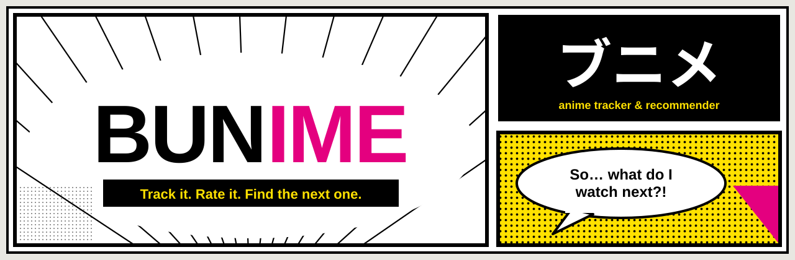
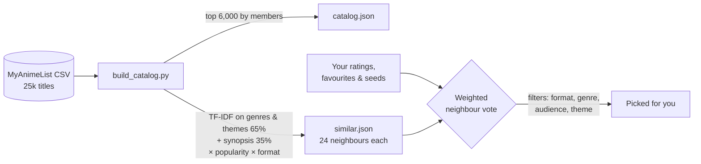

<p align="center">
  <a href="https://shadowbeast0.github.io/Bunime-Anime-Recommender-and-Tracker-App/">
    
  </a>
</p>

<p align="center">
  <a href="https://shadowbeast0.github.io/Bunime-Anime-Recommender-and-Tracker-App/"></a>
  <a href="https://github.com/shadowbeast0/Bunime-Anime-Recommender-and-Tracker-App/actions/workflows/deploy-pages.yml"></a>
  
</p>

<p align="center">
  
  
  
  
  
  
  
</p>

<h3 align="center">Your anime shelf: every season you've watched, every rating you've given,<br>and a recommender that learns from both.</h3>

---

## ⚡ What it does

<table>
<tr>
<td width="33%" valign="top">

### 🎯 Picks from your own ratings
Give a show five stars and its closest matches by **genre, themes and story** jump to the top. Add any title as a seed to steer the results, or hide one with a tap.

</td>
<td width="33%" valign="top">

### 📚 Franchises, untangled
**One Piece**'s 44 seasons, films and specials. Every **Re:Zero** season, OVA and Break Time. They're grouped on one page in release order, with no hand-made mapping. Browse, search and your list show **one card per franchise**, and you can rate or mark a whole franchise in one tap.

</td>
<td width="33%" valign="top">

### ✅ Episode-level tracking
Tap the episode you reached and everything before it is marked. Your list shows titles completed, episodes and hours watched, and your average rating.

</td>
</tr>
<tr>
<td valign="top">

### 🔎 Instant search
Ranked, typo-tolerant search over the bundled catalog, with a live fallback to MyAnimeList (via Jikan) for anything newer or rarer.

</td>
<td valign="top">

### 💾 Your data stays yours
Lists live in your browser's **IndexedDB** with a **localStorage** backup, and the browser is asked for persistent storage. Download a JSON backup and restore it anywhere.

</td>
<td valign="top">

### 📱 Phone to 5K
A bottom tab bar and full-screen search on phones; on 1440p, 4K and 5K screens the whole layout scales up instead of floating in a thin column.

</td>
</tr>
</table>

---

## 🖋️ The look: a weekly manga magazine

Anime comes from print, so the UI borrows the materials of a manga anthology instead of a neon dashboard:

| Ink | Hex | Used for |
|---|---|---|
| ⬛ Black | `#000000` | Panel borders, headlines, text |
| ⬜ Newsprint | `#e8e7e1` | The page |
| 🟥 Process magenta | `#e4007f` | Actions and the active state |
| 🟨 Process yellow | `#ffe100` | **Your** tracking: rated stars, saved statuses, watched episodes |
| 🟦 Process cyan | `#009fe8` | Links and franchise markers |

Headlines are set in **Dela Gothic One** (a Japanese poster gothic), and body text in **Zen Kaku Gothic New**. The home spotlight is laid out as a four-panel manga page, with speed lines and screentone, that draws itself in once on load.

---

## 🧠 How the recommender works



* Every title gets its **24 nearest neighbours**, one per franchise, so you never get five Naruto films in a row.
* Your **5★ titles vote ×2**, **4★ ×1.4**, favourites ×2.5, titles you're watching ×0.6, and **1 to 2★ titles push their neighbours away**.
* Votes are scaled by quality (MAL score) and a boost for your preferred genres. Brand-new profiles fall back to top-rated titles in their favourite genres.

## 🧩 How franchises are grouped

The dataset has **no relation data**, so groups are inferred from titles:

1. A title joins another's franchise when its romaji **or** English name starts with that full title, followed by a sequel marker (`Season`, `2nd`, `Movie`, `Film`, `OVA`, `Part`, a number, …) or by punctuation (`One Piece: Stampede`).
2. Spin-offs sharing a long, distinctive prefix are merged too (`Re:Zero kara Hajimeru Break Time`).
3. Short one-word titles need explicit punctuation, so **Air** and **Air Gear** stay apart.
4. Each group is named after the entry most others extend: the base series.

---

## 🏗️ Architecture

```
Bunime-Anime-Recommender-and-Tracker-App/
├── frontend/                 Next.js 16 app (static export → GitHub Pages)
│   ├── app/                  Landing, auth, dashboard, anime, franchise, profile
│   ├── components/           Cards, tracker controls, navbar, marquee
│   ├── lib/
│   │   ├── api.ts            One client: remote FastAPI or the in-browser API
│   │   ├── localApi.ts       In-browser API (auth, list, recommender, export)
│   │   ├── store.ts          IndexedDB + localStorage persistence
│   │   ├── syncEngine.ts     Cross-device sync (pull → merge → push)
│   │   ├── syncMerge.ts      Conflict-free merge rules (+ tests)
│   │   └── catalog.ts        Catalog loading, search, Jikan live data
│   ├── scripts/
│   │   ├── build_catalog.py  CSV → catalog.json + similar.json (+ franchises)
│   │   └── postexport.mjs    Makes the export work on plain static hosting
│   └── public/data/          Generated catalog (committed)
├── backend/                  Optional FastAPI + MongoDB server
├── supabase/schema.sql       Table + row-level security for sync
└── .github/workflows/        Build & deploy to GitHub Pages on every push
```

The frontend has **two modes**:

| Mode | When | Data |
|---|---|---|
| **Browser** (default, GitHub Pages) | `NEXT_PUBLIC_API_URL` unset | Accounts and lists in IndexedDB on the device |
| **Browser + sync** | `SUPABASE_URL` and `SUPABASE_ANON_KEY` repo variables set | Same, plus a private Supabase row per account, synced across devices |
| **Server** | `NEXT_PUBLIC_API_URL=https://…/api/v1` | FastAPI + MongoDB |

---

## 🚀 Run it locally

```bash
cd frontend
npm ci
npm run dev            # http://localhost:3000
```

Regenerate the catalog after changing `backend/scripts/anime.csv` or the grouping rules:

```bash
pip install pandas numpy scikit-learn
npm run build:catalog  # writes public/data/catalog.json + similar.json
```

<details>
<summary><b>Optional: run the FastAPI backend</b></summary>

```bash
cd backend
python -m venv .venv && source .venv/bin/activate   # Windows: .venv\Scripts\activate
pip install -r requirements.txt
cp .env.example .env                                # set SECRET_KEY and MONGO_URL
python scripts/initial_csv_load.py scripts/anime.csv
uvicorn app.main:app --reload
```

Then start the frontend with `NEXT_PUBLIC_API_URL=http://127.0.0.1:8000/api/v1`.

</details>

## ☁️ Turning on cross-device sync

Sync is optional and free on Supabase's free tier. Without it, lists stay in each browser.

1. Create a project at [supabase.com](https://supabase.com).
2. In **SQL Editor**, run [`supabase/schema.sql`](supabase/schema.sql). It creates one private row per account, locked down with row-level security.
3. In **Authentication → URL Configuration**, set the Site URL to `https://shadowbeast0.github.io/Bunime-Anime-Recommender-and-Tracker-App/`.
4. In **Project Settings → API**, copy the **Project URL** and the **anon public** key.
5. In this GitHub repo, open **Settings → Secrets and variables → Actions → Variables** and add `SUPABASE_URL` and `SUPABASE_ANON_KEY`. Then re-run the deploy workflow.

Then open **Profile → Sync across devices** on each device and sign in to the same sync account. The engine pulls, merges and pushes after every change, when the tab regains focus, and when you come back online. Merging is per title (the newest edit wins, and removals sync too), so two devices edited offline converge without losing anything.

## 🌐 Deploying

Every push to `master` runs [`.github/workflows/deploy-pages.yml`](.github/workflows/deploy-pages.yml). It builds the static export with the right base path and publishes it to **GitHub Pages**. No secrets are needed.

---

## 🛠️ Fixed in this release

- **Deployable as a static site:** the app no longer needs a running server or database.
- **Franchise grouping:** "Re:ZERO" was cut down to "Re" at the colon, and One Piece films weren't grouped. Both now group correctly.
- **Backend export crash:** the export endpoint crashed because `datetime` wasn't imported.
- **ID collisions:** AniList search results could overwrite unrelated MyAnimeList entries with the same ID.
- **Season sync:** the daily season sync wiped English titles, media types and franchise keys.
- **Phone gestures:** episode tracking and hiding a title needed double-click and double-right-click, which don't exist on phones. They're now buttons.
- **Tablet overflow:** cards overflowed on tablets, and the poster strip stretched the page sideways.
- **Placeholder image:** the default cover was a 0-byte file. It's now a real placeholder.
- **Smaller fixes:** login labels weren't linked to their inputs; the Thriller preference matched nothing; and the notification bell did nothing. The bell is now a "surprise me" button.

<p align="center"><sub>Anime data from <a href="https://myanimelist.net">MyAnimeList</a> via <a href="https://jikan.moe">Jikan</a>. Poster images belong to their respective studios.</sub></p>
